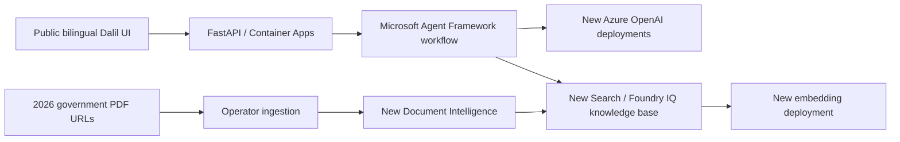

# Dalil Azure Architecture

Reference architecture for the source implementation. This document is not evidence
that a particular customer deployment has completed; record its outputs and acceptance
results separately. Follow the [customer deployment guide](README.md#start-here).

## Dedicated Resources

The core regional resources use `uaenorth`; optional Cosmos history uses the explicitly
approved Cosmos region. Names use the profile's application name, the environment, and a
suffix derived from subscription, project and environment. Provisioning never
references another project's resource IDs, credentials, images or indexes.

| Resource | Planned role |
| --- | --- |
| Resource group | `rg-dalil-dev-<suffix>` isolation boundary |
| Container App + environment | HTTPS ingress, single replica, 0.5 CPU / 1 GiB |
| ACR | Independent image builds and storage |
| Azure AI Search Basic | `dalil-gazettes-2026` file source, `dalil-policies-2026` knowledge base |
| Azure OpenAI | `gpt-5-1` GlobalStandard; `text-embedding-3-large` regional Standard |
| Document Intelligence S0 | Searchable-PDF OCR of scanned Arabic gazettes |
| Managed identity | Scoped runtime Search read, OpenAI use and image pull |
| Log Analytics + Application Insights | Dedicated monitoring resources |
| Key Vault | Deployment secret storage with scoped access |
| Storage | Optional supporting storage; disabled by the customer deployment script |

The new Search identity gets embedding access. Operator OCR and ingestion permissions
are distinct from runtime read permissions. OpenAI/DI local authentication remains
disabled. Storage shared keys and public network access remain disabled. Government
citations need no Storage SAS.

GlobalStandard is explicitly accepted for this demo: a UAE North account is not a
guarantee of UAE-only inference processing. Role assignments are nonregional resources.

## Release Gates

1. Verify current subscription, UAE North service/model availability, quota and RBAC.
2. Compile Bicep, validate scripts and image, estimate costs and obtain deployment approval.
3. Provision only Dalil resources, independently OCR and index the manifest, verify
   ingestion completion and repeat-run idempotence.
4. Test live managed-identity answers in Arabic and English, citations, abstention,
   request limits and service failures. Record actual IDs, image digest and revision.

No deployment IDs or success claims from the source project are included here.